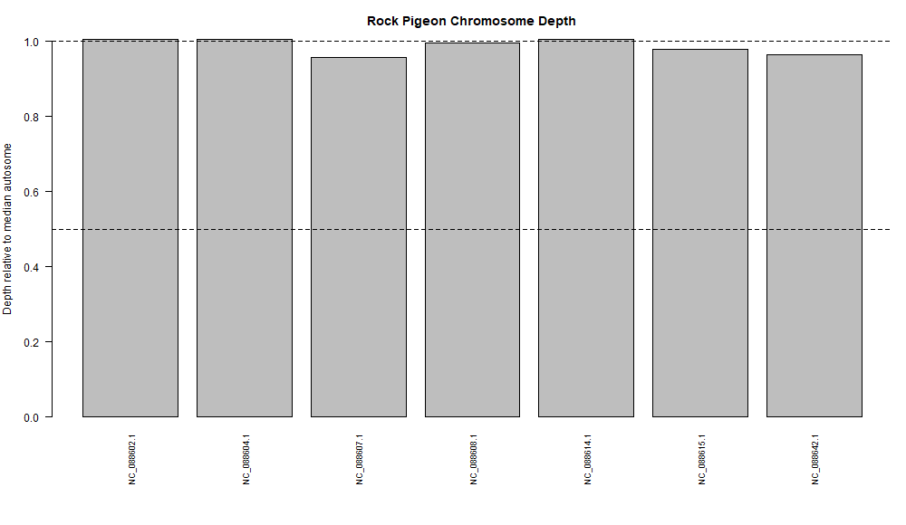

# Sex-Chromosome Dosage Analysis of the Rock Pigeon (*Columba livia*)

## 1. Project Overview

This project investigates sex-chromosome dosage in the rock pigeon (*Columba livia*) using chromosome-level reference genome data and whole-genome sequencing (WGS) reads.

The analysis uses sequencing depth to compare the Z chromosome against selected autosomes to determine whether the observed dosage pattern is consistent with a ZZ or ZW chromosomal complement.

The bioinformatics workflow was performed using Galaxy, while chromosome coverage calculations, relative-depth analysis, interpretation, and visualization were conducted using RStudio 4.3.2.

### Study Objectives

1. Identify the sex-chromosome system of the selected animal species.
2. Obtain a chromosome-level nuclear genome assembly and identify the sex chromosome.
3. Retrieve and process WGS data from NCBI.
4. Assess chromosome-level sequencing coverage using Galaxy.
5. Calculate the Z-to-autosome (Z:A) sequencing depth ratio.
6. Interpret the observed sex-chromosome dosage pattern.

---

## 2. Selected Species and Sex-Chromosome System

**Species:** Rock pigeon  
**Scientific name:** *Columba livia*

The rock pigeon belongs to the family Columbidae and exhibits a ZZ/ZW sex-chromosome system, which is characteristic of birds.

In this system:

- **ZZ:** Two Z chromosomes, typically found in males.
- **ZW:** One Z chromosome and one W chromosome, typically found in females.

Under ordinary diploid conditions, a ZZ individual is expected to have approximately the same Z-chromosome sequencing depth as its autosomes. In contrast, a ZW individual is generally expected to have approximately half the autosomal depth on the Z chromosome, assuming comparable sequencing and mapping conditions.

The ZZ/ZW system makes *Columba livia* suitable for investigating sex-chromosome dosage through chromosome-level sequencing coverage.

---

## 3. Reference Genome and Assembly Information

The reference genome was obtained from the National Center for Biotechnology Information (NCBI).

| Information | Details |
|---|---|
| Organism | *Columba livia* |
| Common name | Rock pigeon |
| Assembly name | bColLiv1.pat.W.v2 |
| RefSeq assembly accession | GCF_036013475.1 |
| Assembly level | Chromosome-level |
| Assembly BioSample | SAMN38891892 |
| Sex-chromosome system | ZZ/ZW |
| Sex chromosome analyzed | Z |
| Z chromosome accession | NC_088642.1 |

**NCBI Assembly:**  
https://www.ncbi.nlm.nih.gov/datasets/genome/GCF_036013475.1/

**Assembly BioSample:**  
https://www.ncbi.nlm.nih.gov/biosample/SAMN38891892

The NCBI BioSample record identifies the reference assembly donor as female. This information describes the assembly donor and must not be used to assign the sex of the separate WGS donor analyzed in this project.

### 3.1 Selected Chromosomes

Six autosomes and one sex chromosome were selected for the coverage analysis.

| Chromosome | RefSeq accession | Classification |
|---|---|---|
| Chromosome 1 | NC_088602.1 | Autosome |
| Chromosome 3 | NC_088604.1 | Autosome |
| Chromosome 6 | NC_088607.1 | Autosome |
| Chromosome 7 | NC_088608.1 | Autosome |
| Chromosome 13 | NC_088614.1 | Autosome |
| Chromosome 14 | NC_088615.1 | Autosome |
| Z chromosome | NC_088642.1 | Sex chromosome |

The chromosome accessions were matched with the NCBI RefSeq records associated with the selected assembly. Their accession identifiers were also checked against the chromosome names appearing in the Galaxy Samtools output.

The six autosomes served as the reference group for calculating median autosomal sequencing depth. The Z chromosome was analyzed separately as the target sex chromosome.

The chromosome classifications are provided in `chromosome_groups.csv`.

---

## 4. Whole-Genome Sequencing Dataset

The WGS dataset was retrieved from the NCBI Sequence Read Archive (SRA).

| Information | Details |
|---|---|
| Run accession | SRR10103017 |
| Experiment accession | SRX6834885 |
| BioSample accession | SAMN12697400 |
| BioProject accession | PRJNA532675 |
| Organism | *Columba livia* |
| Sequencing platform | Illumina HiSeq 2000 |
| Sequencing strategy | Whole-genome sequencing |
| Library layout | Paired-end |
| Read length | 150 bp |
| Number of spots | 42,060,090 |
| Total bases | Approximately 12.6 Gb |

**NCBI SRA record:**  
https://www.ncbi.nlm.nih.gov/sra/SRR10103017

**WGS BioSample:**  
https://www.ncbi.nlm.nih.gov/biosample/SAMN12697400

### 4.1 Comparison of Assembly and WGS BioSamples

| Information | Reference assembly | WGS dataset |
|---|---|---|
| BioSample accession | SAMN38891892 | SAMN12697400 |
| Biological individual | VGP racing homer pigeon | Homing pigeon |
| Recorded sex | Female | Not collected |
| Data used | Reference genome assembly | WGS reads |

The two BioSample accessions are different, indicating that the reference assembly and WGS dataset originated from different biological samples.

The reference assembly donor was recorded as female, whereas the sex of the WGS donor was not collected in its NCBI BioSample record.

Therefore, the inferred sex-chromosome dosage pattern in this project applies only to the WGS donor. The reference assembly donor's recorded sex cannot be used as direct validation of the WGS result.

---

## 5. Bioinformatics Workflow

The bioinformatics workflow was performed using Galaxy.

### 5.1 Retrieval of WGS Reads

The paired-end WGS dataset associated with accession SRR10103017 was retrieved and imported into Galaxy.

The forward and reverse reads were maintained as paired-end sequencing data.

### 5.2 Quality Control Using FastQC

FastQC was performed to evaluate the quality of the raw sequencing reads.

The quality assessment included:

- Per-base sequence quality
- Per-sequence quality scores
- Per-base sequence content
- GC content
- Sequence duplication levels
- Overrepresented sequences
- Adapter content

The FastQC reports were retained for documentation.

### 5.3 Read Alignment Using BWA-MEM2

The paired-end reads were aligned against the selected *Columba livia* reference genome using BWA-MEM2.

The resulting alignments were generated in BAM format.

### 5.4 BAM Sorting and Extraction

The aligned BAM data were processed using Samtools Sort.

The sorted BAM file was extracted from the Galaxy collection to obtain an individual BAM dataset for subsequent coverage analysis.

### 5.5 Alignment Statistics Using Samtools Flagstat

Samtools Flagstat was used to summarize the alignment statistics.

The resulting alignment statistics included:

| Alignment statistic | Result |
|---|---:|
| Total reads | 85,731,318 |
| Primary reads | 84,120,180 |
| Mapped reads | 85,050,550 |
| Overall mapped percentage | 99.21% |
| Primary mapped reads | 83,439,412 |
| Properly paired reads | 77,666,030 |
| Properly paired percentage | 92.33% |

These statistics describe the alignment output generated from the selected WGS dataset.

### 5.6 Chromosome Statistics Using Samtools Idxstats

Samtools Idxstats was used to obtain reference-sequence statistics from the sorted BAM file.

The output contained chromosome accession identifiers and corresponding alignment statistics.

The accession identifiers were checked against the selected chromosome groups to ensure that the intended autosomes and Z chromosome were represented in the coverage analysis.

### 5.7 Chromosome Coverage Using Samtools Coverage

Samtools Coverage was used to calculate sequencing coverage across the reference sequences.

The following parameters were applied:

| Parameter | Value |
|---|---:|
| Minimum read length | 0 |
| Minimum mapping quality | 20 |
| Minimum base quality | 20 |
| Histogram output | No |

The tool generated a tabular output containing chromosome-level coverage information, including:

- Reference sequence name
- Start and end positions
- Number of reads
- Covered bases
- Percentage coverage
- Mean sequencing depth
- Mean base quality
- Mean mapping quality

The resulting coverage table was exported from Galaxy as `chromosome_coverage.tsv`.

### 5.8 Data Processing and Analysis Using R

The Samtools coverage output and chromosome classification file were imported into RStudio 4.3.2.

A custom R script, `sex_depth_analysis.R`, was used to:

1. Read the chromosome coverage data.
2. Identify the selected autosomes and Z chromosome.
3. Calculate the median autosomal sequencing depth.
4. Calculate relative chromosome depth.
5. Calculate the Z-to-autosome depth ratio.
6. Interpret the observed dosage pattern using the provided classroom thresholds.
7. Generate a chromosome-depth visualization.
8. Export the numerical results and interpretation.

---

## 6. Results

### 6.1 Chromosome Coverage

The chromosome coverage analysis generated a table containing 869 reference-sequence records.

For the selected chromosomes, the median autosomal sequencing depth was calculated as **8.245×**.

The Z chromosome had a mean sequencing depth of **7.95028×**.

### 6.2 Relative Chromosome Depth

Relative chromosome depth was calculated by dividing the mean sequencing depth of each chromosome by the median autosomal sequencing depth.

The formula used was:

\[
\text{Relative Depth} =
\frac{\text{Mean Chromosome Depth}}
{\text{Median Autosome Depth}}
\]

The resulting values are presented below.

| Chromosome | Mean depth | Relative depth |
|---|---:|---:|
| Chromosome 1 | 8.28802 | 1.005279 |
| Chromosome 3 | 8.27973 | 1.004273 |
| Chromosome 6 | 7.88439 | 0.956321 |
| Chromosome 7 | 8.20927 | 0.995727 |
| Chromosome 13 | 8.28754 | 1.005220 |
| Chromosome 14 | 8.05530 | 0.977051 |
| Z chromosome | 7.95028 | 0.964313 |

The Z chromosome exhibited a relative depth of 0.964313, indicating that its sequencing depth was approximately 96.4% of the median autosomal depth.

### 6.3 Z-to-Autosome Ratio

The Z-to-autosome ratio was calculated using:

\[
Z:A =
\frac{\text{Mean Z Chromosome Depth}}
{\text{Median Autosomal Depth}}
\]

Substituting the observed values:

\[
Z:A = \frac{7.95028}{8.245}
\]

\[
\boxed{Z:A = 0.964}
\]

The resulting ratio was approximately 0.964.

### 6.4 Chromosome Depth Visualization

The following figure illustrates the relative sequencing depth of the six selected autosomes and the Z chromosome.

**Figure 1.** Relative sequencing depth of selected autosomes and the Z chromosome in *Columba livia*. Values are normalized against the median autosomal sequencing depth.

### 6.5 Sex-Chromosome Dosage Interpretation

According to the laboratory handout, an ordinary diploid ZZ individual is generally expected to have a Z:A ratio near 1.0, whereas a ZW individual is generally expected to have a ratio near 0.5.

The provided R script uses the following classroom interpretation guidelines:

| Z:A ratio | Dosage interpretation |
|---|---|
| ≥ 0.80 | Two-copy, ZZ-like pattern |
| ≤ 0.65 | One-copy, ZW-like pattern |
| Between 0.65 and 0.80 | Ambiguous |

The observed Z:A ratio of **0.964** exceeded the 0.80 threshold.

Therefore, the result was classified as a:

**ZZ-like dosage pattern.**

The W/Y relative depth was reported as `NA` because the analysis included the Z chromosome but did not include the W chromosome.

---

## 7. Answers to the Laboratory Report Questions

### Question 1. What species did you choose, and what evidence supports a diploid XX/XY or ZZ/ZW system?

The selected species was the rock pigeon (*Columba livia*), which exhibits a ZZ/ZW sex-chromosome system characteristic of birds.

In this system, males typically possess two Z chromosomes (ZZ), while females possess one Z chromosome and one W chromosome (ZW).

The species' established avian sex-chromosome system supports its suitability for investigating sex-chromosome dosage through sequencing depth.

### Question 2. What are your assembly accession, WGS run, and both BioSample accessions? Are the donors the same?

The reference genome assembly used was GCF_036013475.1 (bColLiv1.pat.W.v2).

The WGS dataset was obtained from SRA run SRR10103017.

The corresponding BioSample accessions were:

- Reference assembly BioSample: SAMN38891892
- WGS BioSample: SAMN12697400

The donors were not the same because the two datasets have different BioSample accessions.

The reference assembly donor was recorded as female, while the WGS donor's sex was reported as not collected in the NCBI BioSample record.

Consequently, the assembly donor's recorded sex cannot be used to validate the inferred dosage pattern of the WGS donor.

### Question 3. Which sequences were used as autosomes and as X or Z? How did you verify their identities?

Six autosomes and one Z chromosome were selected.

The autosomal sequences were:

- NC_088602.1 — Chromosome 1
- NC_088604.1 — Chromosome 3
- NC_088607.1 — Chromosome 6
- NC_088608.1 — Chromosome 7
- NC_088614.1 — Chromosome 13
- NC_088615.1 — Chromosome 14

The Z chromosome sequence was:

- NC_088642.1 — Chromosome Z

Their identities were matched with the NCBI RefSeq records associated with the selected assembly. The accession identifiers were also checked against the reference sequences listed in the Galaxy Samtools Idxstats and Coverage outputs.

The six autosomes were assigned to group A, while the Z chromosome was assigned to group Z in `chromosome_groups.csv`.

### Question 4. What are the median autosomal depth, X:A or Z:A ratio, and inferred sex-chromosome complement?

The median autosomal sequencing depth was **8.245×**.

The mean sequencing depth of the Z chromosome was **7.95028×**.

The calculated Z:A ratio was **0.964**.

Because the ratio was above the classroom threshold of 0.80, the observed sequencing depth was classified as a **ZZ-like dosage pattern**.

This interpretation indicates that the Z chromosome exhibited sequencing depth close to the autosomal baseline.

### Question 5. Does your result agree with the recorded sex of the WGS donor, if reported? Explain any discrepancy or uncertainty.

The WGS BioSample (SAMN12697400) reported that the donor's sex was not collected.

Therefore, there is no independently recorded sex for the WGS donor against which the inferred ZZ-like dosage pattern can be compared.

Although the reference assembly BioSample (SAMN38891892) recorded its donor as female, this was a different biological individual from the WGS donor.

The observed Z:A ratio of 0.964 is consistent with a ZZ-like dosage pattern, but the biological sex of the WGS donor cannot be independently confirmed from the available metadata.

### Question 6. Why is a chromosome-level assembly alone insufficient for a reliable read-depth sex inference?

A chromosome-level assembly provides information about the organization and identity of chromosome sequences, but it does not independently establish the sex-chromosome dosage of a separate sequenced individual.

Read-depth sex inference requires sequencing reads from the biological sample to be aligned against a reference genome. The resulting coverage across autosomes and sex chromosomes can then be compared to investigate relative chromosome dosage.

The presence of a sex-chromosome sequence in an assembly does not establish whether an individual carries one or two copies of that chromosome. Assembly representation, haplotype selection, incomplete chromosome sequences, and assembly donor characteristics can also affect interpretation.

Furthermore, mapping bias, repetitive sequences, low sequencing depth, and poorly differentiated sex-linked regions may distort coverage ratios.

Therefore, chromosome-level reference information must be combined with appropriately mapped WGS reads and chromosome-level coverage analysis to investigate sex-chromosome dosage.

---

## 8. Limitations

Several limitations should be considered when interpreting the results.

1. **Different biological donors:** The reference assembly and WGS dataset originated from different individuals. The recorded sex of the reference assembly donor cannot validate the inferred dosage pattern of the WGS donor.

2. **Unavailable WGS donor sex:** The NCBI BioSample record for SRR10103017 reported that sex was not collected. Independent confirmation of the WGS donor's biological sex was therefore unavailable.

3. **Limited autosomal selection:** Only six autosomes were selected as the autosomal reference group rather than using all autosomes.

4. **W chromosome not analyzed:** The analysis focused on the Z chromosome. The W chromosome was not included in the selected chromosome groups, so its relative sequencing depth could not be evaluated.

5. **Mapping bias:** Differences in sequence composition, repetitive regions, and reference representation may influence read alignment and chromosome coverage.

6. **Sequencing depth:** The available sequencing depth may affect the precision of chromosome-level coverage estimates.

7. **Teaching thresholds:** The dosage classification thresholds used in the R script are classroom guidelines and should not be interpreted as universal diagnostic thresholds.

Considering these limitations, the result should be interpreted as a sequencing-depth-based dosage inference rather than definitive biological sex determination.

---

## 9. Conclusion

The sex-chromosome dosage analysis of the rock pigeon (*Columba livia*) produced a median autosomal sequencing depth of 8.245× and a Z-chromosome mean sequencing depth of 7.95028×.

The resulting Z:A ratio was 0.964, indicating that the Z chromosome exhibited sequencing depth close to the autosomal baseline.

Based on the classroom interpretation criteria, the observed pattern was classified as ZZ-like.

However, the biological sex of the WGS donor could not be independently confirmed because sex was not collected in the corresponding NCBI BioSample record. The reference assembly donor was recorded as female, but the assembly and WGS donors were different individuals.

Overall, this activity demonstrates how chromosome-level reference genomes, whole-genome sequencing, read alignment, chromosome coverage analysis, and R-based calculations can be integrated to investigate sex-chromosome dosage in animals.

---

## 10. Project Files and Outputs

The following files were generated during the analysis.

| File | Description |
|---|---|
| `chromosome_groups.csv` | Classification of selected autosomes and Z chromosome |
| `chromosome_coverage.tsv` | Samtools chromosome coverage output |
| `sex_depth_analysis.R` | R script used for dosage calculations and visualization |
| `results/chromosome_depth.png` | Relative chromosome depth graph |
| `results/chromosome_relative_depth.csv` | Mean and relative chromosome depth values |
| `results/sex_inference.txt` | Summary of the sex-chromosome dosage interpretation |
| `FastQC_Results/` | FastQC quality assessment outputs |

Large FASTQ, FASTA, BAM, and CRAM files are not included in this repository. Their accession information is provided through the corresponding NCBI records.

---

## 11. Tools and Resources

The following tools and databases were used:

- **NCBI Genome:** https://www.ncbi.nlm.nih.gov/datasets/
- **NCBI Sequence Read Archive:** https://www.ncbi.nlm.nih.gov/sra
- **NCBI BioSample:** https://www.ncbi.nlm.nih.gov/biosample/
- **Galaxy:** https://usegalaxy.org/
- **FastQC:** Raw sequencing read quality assessment
- **BWA-MEM2:** Sequence alignment
- **Samtools:** BAM processing, alignment statistics, and chromosome coverage
- **RStudio 4.3.2:** Data processing, dosage calculations, and visualization

### References

1. National Center for Biotechnology Information (NCBI). *Columba livia* reference genome assembly GCF_036013475.1. https://www.ncbi.nlm.nih.gov/datasets/genome/GCF_036013475.1/

2. National Center for Biotechnology Information (NCBI). BioSample SAMN38891892: Reference genome sample of *Columba livia*. https://www.ncbi.nlm.nih.gov/biosample/SAMN38891892

3. National Center for Biotechnology Information (NCBI). BioSample SAMN12697400: Whole-genome sequencing sample of *Columba livia*. https://www.ncbi.nlm.nih.gov/biosample/SAMN12697400

4. National Center for Biotechnology Information (NCBI). SRA run SRR10103017. https://www.ncbi.nlm.nih.gov/sra/SRR10103017

5. National Center for Biotechnology Information (NCBI). BioProject PRJNA532675: *Columba livia* genome sequencing. https://www.ncbi.nlm.nih.gov/bioproject/PRJNA532675
